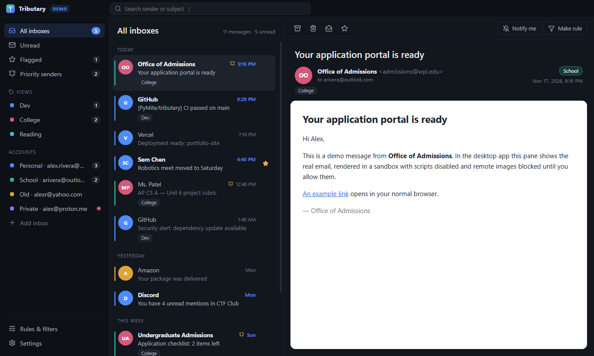

# Tributary

**Every inbox, one stream.** A local-first desktop app that unifies Gmail, Outlook, Yahoo, iCloud, AOL, Proton (via Bridge) and any IMAP inbox, with rules that span accounts and desktop notifications for the senders you pick.



- **Unified inbox.** Every account in one list. A color stripe shows which inbox each message came from.
- **Rules across all accounts.** Match on sender, sender domain, recipient, subject or account (contains / is / starts with / ends with / regex). A rule can put mail in a sidebar view, notify you, mark it read, or keep it out of "All inboxes".
- **Priority senders.** A one-click "Notify me" in the reader gives you a desktop notification whenever that address emails any of your accounts.
- **Real-time.** IMAP IDLE, with reconnect backoff.
- **Private.** No server and no telemetry. Credentials are encrypted with the OS keystore (`safeStorage` / DPAPI). Email HTML renders in a script-less sandbox, and remote images are blocked until you allow them.
- **Keyboard.** `j`/`k` move · `e` archive · `#` delete · `s` star · `u` unread · `/` search.

Website and setup guide: [`docs/`](docs/) (GitHub Pages).

## Run it

```bash
npm install
npm run dev        # Vite + Electron with hot reload
npm start          # production build of the UI, then Electron
npm test           # rules engine tests
npm run preview:web  # the UI in a browser with demo data (no Electron)
```

Demo data inside Electron (used for the screenshots in `docs/assets/`):

```powershell
$env:TRIBUTARY_DEMO=1; $env:TRIBUTARY_DEMO_VIEW='reader'   # reader | rules | account
$env:TRIBUTARY_SHOT="$PWD\docs\assets\screenshot-reader.png"; npm start
```

## How each provider logs in

| Provider | Auth | Notes |
|---|---|---|
| Gmail | App password (or OAuth) | Needs 2-Step Verification |
| Outlook / Hotmail / Live | **OAuth only** | Microsoft disabled IMAP password auth for consumer accounts |
| Yahoo, AOL, iCloud | App password | |
| Proton | Bridge password | Requires [Proton Mail Bridge](https://proton.me/mail/bridge) running locally (`127.0.0.1:1143`, STARTTLS) |
| Anything else | Password | Any IMAP server |

### OAuth setup

Outlook needs a Microsoft app registration, and Gmail can optionally use one. Paste the IDs into **Settings → Sign-in providers** (saved to `userData/oauth.config.json`), or put them in `oauth.config.json` in the project root (gitignored):

```json
{
  "microsoft": { "clientId": "..." },
  "google": { "clientId": "....apps.googleusercontent.com", "clientSecret": "GOCSPX-..." }
}
```

Step-by-step registration for both: [docs/setup.html#oauth](docs/setup.html#oauth).

### How credentials are kept

- Sign-in stores the provider's **refresh token**, or the app password, encrypted with `safeStorage` (DPAPI on Windows), in `userData/accounts.json`. There are no cookies and no stored account passwords.
- Access tokens live in memory only and refresh 5 minutes before they expire. Microsoft's rotated refresh tokens are re-encrypted and saved.
- When the server rejects an access token, it is dropped and refreshed once. If the refresh returns `invalid_grant`, an app password is rejected, or a fresh token is rejected again, the session **stops** in a `reauth` state. It doesn't loop on bad credentials, which can lock accounts. The UI then shows a banner, a single notification, and *Sign in again* / *new app password* in Settings (`account:reauth` keeps the account's id, cache, and rules). Covered by `test/session-auth.test.cjs` against a fake IMAP server.

## Layout

```
electron/
  main.cjs       window, tray, notifications, IPC, account lifecycle
  preload.cjs    the only bridge the UI gets (contextIsolation + sandbox)
  mail.cjs       AccountSession: IMAP connect / IDLE / sync / body fetch / flags / move
  rules.cjs      pure rules engine (tested in test/)
  oauth.cjs      PKCE + loopback redirect for Google and Microsoft
  store.cjs      JSON persistence in userData; secrets via safeStorage
  providers.cjs  IMAP presets
src/             React UI (Vite). demo.js is a fake backend for browser preview.
docs/            GitHub Pages site
scripts/         dev launcher, icon generator
```

## Status

v0.1. Reads and triages INBOX across accounts. Not built yet: composing/replying, folders other than INBOX, full-text body search, and a packaged installer.

## License

MIT
